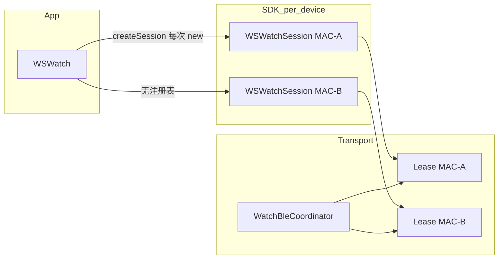
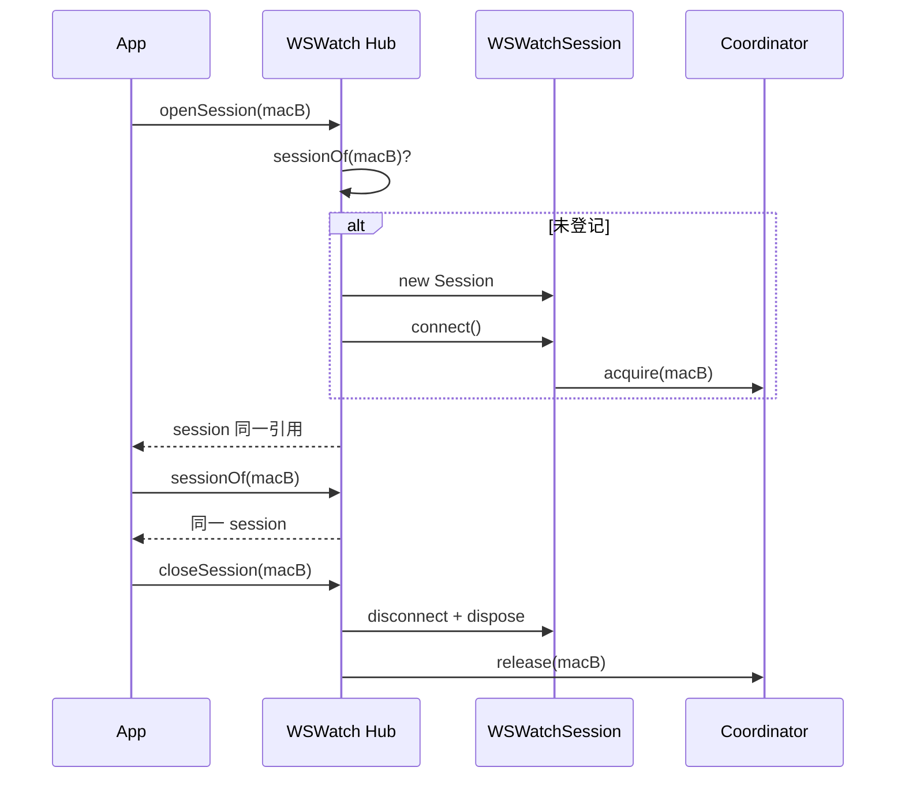

# WS Watch：多设备连接与 Session Hub 设计

**已实现（2026-11-12）**：JW 与 WS SDK / Demo 均已落地。下方原始提案保留用于设计背景，API 与生命周期以本节为准。JW 实现见 [JW Session Hub](jw-watch-multi-device-session-hub.md)。

## 当前实现与验证入口

`WSWatch` 是扫描、数据库及 Session 的唯一所有者；App 通过依赖注入共享一个 Watch。每台设备独立 Link、命令队列、ACK 序号、认证身份和历史数据作用域。SDK 不维护“当前设备”，选择状态属于 Demo。

```dart
final watch = WSWatch(config: const WSConfig.simulation()); // 或 WSConfig.ble()
await watch.initialize();
final a = await watch.openSession(kWsWatchSimDeviceId);
final b = await watch.openSession(kWsWatchSimDeviceId2);
await Future.wait([a.connect(), b.connect()]);
await Future.wait([
  a.bindFirstTime('123456', confirmed: true),
  b.bindFirstTime('123456', confirmed: true),
]);
await watch.closeSession(kWsWatchSimDeviceId); // B 保持连接
await watch.dispose(); // 等待所有连接和历史写入释放后关闭自有数据库
```

| API / 约定 | 已实现行为 |
| --- | --- |
| `openSession(id)` | 只创建或获取，不自动连接；活动 Session 去重，旧代关闭后才能建立新代。 |
| `createSession(id)` | 同步兼容入口，也由 Hub 管理；旧代正在清理时抛 `unavailable`，改用异步入口。 |
| `sessionOf(id)` | 返回可用活动实例；关闭、已结束或不存在时为 null。 |
| `attachedSessionsSnapshot` / `attachedSessions` | 不可变快照 / 异步广播变化流（不重播）；包含 Session、状态、模拟标记、关闭中和清理错误。 |
| `closeSession` / `closeAllSessions` | 并发关闭去重；批量尝试所有设备，失败保留条目与容量，可重试；批量错误含 `failures`。 |
| ID | BLE 注册键 trim + 小写；连接目标及历史作用域保留扫描 ID 的原始大小写；模拟 ID 区分大小写。 |
| 容量 | 默认 4 个连接、64 个挂载对象，可在 Watch 构造时配置；连接中和清理失败也计入连接容量。 |
| Session 生命周期 | 单次使用；断线/失败自动回收。重连调用 `openSession` 获取新实例。 |
| ACK 与错误 | WS 保留 5 秒 ACK、最多 3 次重发。业务回复不替代 WS L1 ACK；ACK/写入/业务超时属于本次调用失败，真实断线才结束 Session。 |
| 历史同步 | 失败回调与抛错保留同一错误码；断线/关闭即时结束，等待写入收尾。 |

Demo 首页增加“扫描并添加设备”，顶部列表可切换与单台关闭；添加 B 保留 A。数据与设置页面按 Session 重建，忙碌状态、电量、能力缓存与历史同步进度各自隔离。切换设备或 Tab 不会销毁另一台的同步控制器。切换 BLE / 模拟模式前需关闭所有连接。

模拟模式提供 `ws-watch-simulator` 与 `ws-watch-simulator-2`，使用真实 WS 帧通道和 L2 命令，独立绑定状态与配置，电量分别 75 / 55，心率首条分别 72 / 82。历史时间戳在模拟设备生命周期内固定，重复同步不会随秒数变化而重复插入。

SDK 未提供的 Demo API 继续保留原占位（如语言写入、时制/单位、联系人、通知、目标、部分屏幕与提醒设置，以及同步标记重置/清设备数据）；占位返回值不代表真机已执行。此次没有扩充这些业务协议。

自动化验证包含 Hub 去重与容量、关闭失败重试、ACK 重发及队列继续、双模拟表并行同步与存储隔离、同步错误回调、关闭重连、Demo 扫描添加/切换/单台关闭和切换期间异步结果隔离。真机双 BLE 的连接上限、系统后台行为和固件业务能力仍需实测。

## 原始设计提案（背景资料）

---

## 1. 目标与非目标

### 1.1 目标

| 项 | 说明 |
| --- | --- |
| **多路并存** | 多块表（不同 MAC / 不同 Sim ID）可同时 `connect` + 业务 API（设置、点测、同步等），各自独立 `WSWatchSession` / `WSLink`。 |
| **SDK 代管** | `WSWatch` 维护 **设备 MAC → 活动 Session** 注册表；App 任意页面调用 `sessionOf(mac)` / `openSession(mac)` 得到**同一实例**。 |
| **可观测** | 暴露 **汇总连接态**（列表、`Stream`），便于首页徽章、设备切换器、调试页。 |
| **Demo 示范** | `ws_watch_demo` 提供 **多设备连接 + 当前操作设备切换**，代码路径与产品 App 一致（薄 Controller，不再造私有 Session 池）。 |
| **传输对齐** | 复用现有 `WatchBleCoordinator`（按 deviceId 分 lease）与 `WatchSimulationTransport.register`（多 Sim 设备）。 |

### 1.2 非目标（本阶段）

- **同 MAC 双连接**：仍禁止（Coordinator `busy`）；Hub 只 dedupe，不突破 GATT 单占用。
- **跨 Session 事务**（如一键全网同步）：可后续加编排层，Hub 不内建。
- **JW SDK 同步改造**：本文以 WS 先行；JW 可后续镜像 Hub（可选）。
- **宿主多 `WSWatch` 实例**：默认 **单 Isolate 单 `WSWatch` + 单 Coordinator**；多实例需注入独立 Coordinator（测试用）。

---

## 2. 现状快照

### 2.1 传输层（已具备多设备基础）



| 组件 | 多设备行为 |
| --- | --- |
| `WatchBleCoordinator.acquire` | **不同** `deviceId` 可同时占用；**相同** MAC 第二次 `acquire` → `WatchTransportErrorCode.busy`。 |
| `WatchSimulationTransport` | `register` 多设备；**同一 Sim ID** 同时只能一个 `createConnection`（`_owners`）。 |
| `WatchBleCoordinator.startScan` | 全局 **单扫描租约**；与 `exclusive` 连接互斥（当前 Demo 连接前 `stopScan`）。 |
| `WSHistoryStore` | **全局单库**；历史按 `WSHistoryScope(userId + deviceMac)` 隔离，多 Session 共享 store **合理**。 |

### 2.2 SDK 门面（缺口）

`WSWatch.createSession(deviceMac)`（见 `ws_watch.dart`）：

- **每次调用都 new** `WSWatchSession` + 新 `WatchTransportConnection`。
- **无注册表**：谁 `createSession` 谁持有；丢引用 = 泄漏连接或无法再次拿到同一 Session。
- **`dispose()`** 只关扫描与 DB，**不枚举关闭** 已创建的 Session。

`WSWatchSession` 仍为 **一表一会话** 单元（`WSLink`、phase、`historyScope`），设计正确；缺的是 **Watch 级所有权**。

### 2.3 Demo（单 Session 产品假设）

`WSDemoController.connect`：

1. `await _session?.dispose()` —— **连新表必拆旧表**。
2. 单一 `_session` + `_state` 镜像 —— UI 无法展示多路连接。
3. `WSDemoController` 被误当成「SDK 必备层」；实为单设备胶水。

与 [公开 API 冻结](ws-watch-public-api-freeze.md) 中「多 Session 可共享同一 `WSWatch`」的 **文字规则** 一致，但 **未提供 Hub API**，App 只能自管 Map。

### 2.4 模拟器（验收缺口）

- 仅注册 **`kWsWatchSimDeviceId` 一台** Sim。
- 无法在 Sim 下验收 **双表并行**（除非两路都走 BLE 或改 transport 测试注入）。

---

## 3. 问题清单（为何要做 Hub）

| # | 问题 | 影响 |
| --- | --- | --- |
| P1 | **重复 `createSession` 同 MAC** | 第二路 `connect` 触发 transport `busy` 或孤儿 Session。 |
| P2 | **App 跨页面丢 Session 引用** | 只能再 `createSession`，与 P1 叠加。 |
| P3 | **无全局连接视图** | 产品无法做「已连接设备列表 / 当前操作设备」。 |
| P4 | **Demo 强制单连接** | 集成方照抄 Demo 会永远单表。 |
| P5 | **扫描与连接策略未文档化** | 多表时是否允许「已连接继续扫描加表」需明确（Coordinator 允许无 scan 时多 lease）。 |
| P6 | **平台 BLE 并发上限** | Android 常见 practical 上限 ~5–7；Hub 应可配置 `maxActiveSessions` 并友好失败。 |
| P7 | **`WSWatch.dispose` 未级联** | 进程退出或 SDK 重建时可能遗留 GATT。 |

---

## 4. 架构决策：Session 谁管？

| 方案 | 优点 | 缺点 |
| --- | --- | --- |
| **A. App 自管 `Map<mac, Session>`** | SDK 改动小 | 每个宿主重复逻辑；易与 Coordinator 规则打架；不符合产品 SDK 预期。 |
| **B. SDK Hub（推荐）** | 单一真源、可重复获取、统一 dispose、可广播状态 | 需在 `WSWatch` 增 API 与生命周期；要写清与旧 `createSession` 关系。 |
| **C. 全局单例 `WSConnectionService`** | 与 Flutter 习惯接近 | 测试注入难；与 `WSWatch` 双入口；与 JW 镜像门面不一致。 |

**结论（与负责人倾向一致）**：采用 **B — `WSWatch` 内置 Session Hub**。App **只持有 `WSWatch`**（或 DI 容器中的同一实例），通过 Hub 获取 Session；**不再**在业务层维护长期 `WSWatchSession?`。

`WSWatchSession` 仍是 **命令与状态边界**（settings/measure/sync 挂在 session 上）；Hub 只管 **实例生命周期与索引**。

---

## 5. 公开 API 草案（W5.7+ / Hub 里程碑）

命名待 W5.0 增量评审；语义如下。

### 5.1 类型

```dart
/// 只读快照，便于列表 UI。
final class WSAttachedSession {
  const WSAttachedSession({
    required this.deviceMac,
    required this.session,
    required this.state,
    required this.isSimulated,
  });

  final String deviceMac;
  final WSWatchSession session;
  final WSSessionState state;
  final bool isSimulated;
}
```

### 5.2 `WSWatch` 扩展

| API | 语义 |
| --- | --- |
| `Stream<List<WSAttachedSession>> get attachedSessions` | 当前 Hub 管理的全部 Session 及其最近 state（connecting/connected/ready/…）。 |
| `List<WSAttachedSession> get attachedSessionsSnapshot` | 同步快照。 |
| `WSWatchSession? sessionOf(String deviceMac)` | **已登记且未 dispose** 则返回**同一对象**；否则 `null`。大小写按 MAC 规范化（与 Coordinator 一致）。 |
| `Future<WSWatchSession> openSession(String deviceMac)` | 若已有则返回；若无则 `create` + 登记 + 可选自动 `connect()`（见 §5.3）。 |
| `Future<void> connectSession(String deviceMac)` | 对已有或新建的 Session 执行 `connect()`。 |
| `Future<void> closeSession(String deviceMac)` | `disconnect` + `dispose` + 从 Hub 移除；**不影响**其他 MAC。 |
| `Future<void> closeAllSessions()` | 登出/切换账号等场景。 |
| `String? get focusedDeviceMac` / `setFocusedDeviceMac` | 可选：**UI 操作焦点**（点测 SnackBar、通知路由）；**不等于**唯一连接。 |
| `int maxAttachedSessions` | 默认 4 或 7；超限 `openSession` 抛 `WSException` / `StateError`（待选码）。 |

### 5.3 `createSession` 兼容策略

| 策略 | 说明 |
| --- | --- |
| **推荐（破坏性可接受时）** | `createSession` **标记 `@Deprecated`**，文档指向 `openSession`；Hub 外 new 的 Session **不登记**（仅测试/高级场景）。 |
| **过渡** | `createSession` 行为改为 **`return openSession(mac)` 的同步登记部分**（仍返回 Session，但进 Hub）；已存在则返回同一实例。 |

无论哪种，**同一 MAC 在 Hub 内最多一个活动 Session**。

### 5.4 生命周期



- **`WSWatch.dispose()`**：先 `closeAllSessions()`，再关 DB/扫描（补齐 P7）。
- **Session 自调 `dispose()`**：Hub **监听**或 **wrap**，从表移除（防 App 绕过 Hub）。

---

## 6. Demo 改造方案

### 6.1 原则

- **`WSDemoController` 变薄**：持有 `WSWatch`；**删除**「连接 = dispose 旧 session」语义。
- UI：**已连接设备列表** + **当前焦点设备**（`focusedDeviceMac`）；业务页通过 `watch.sessionOf(focused)?.…` 或 Controller 转发。
- 扫描页：支持 **已连接状态下继续扫描** 并「添加连接」（若平台扫描与多 GATT 并存需真机验证；Sim 无 scan 互斥问题）。

### 6.2 建议界面增量（W5.5 或 Hub 子任务）

| 区域 | 行为 |
| --- | --- |
| 连接页 | 多台 Sim / 多台 BLE（工装）并列显示 phase；可对单台 `断开`。 |
| 顶栏 / 抽屉 | 设备切换器：切换 `focusedDeviceMac`，下方业务 Tab 随焦点 Session 变。 |
| 数据同步 | 按设备 `historyScope` 同步；列表展示每台 sync 进度（可多 listener）。 |
| 代码示例 | `ws_watch_lab_home.dart` 注释块：`final s = watch.sessionOf(mac)!; await s.measure…` |

### 6.3 与错误 UX 一致

- 仍 **页面级 `try/catch`** + `wsDemoRunWithSnackBar`。
- `sessionBusy` 可细化为 **按 MAC 的 busy 计数** 或保留全局（Hub 里程碑可选）。

---

## 7. 模拟器多设备验收

| 步骤 | 内容 |
| --- | --- |
| Sim-1 | 保留现有 `kWsWatchSimDeviceId`。 |
| Sim-2 | 新增常量如 `kWsWatchSimDeviceId2` + 第二台 `WsSimWatchState` / `register` 第二条 `WatchSimulationDevice`。 |
| 扫描列表 | `startScan` 广播 **两台** Sim 条目。 |
| 测试 | `ws_watch_sdk` 集成测：双 `openSession` → 双 `bindFirstTime`（不同 userId）→ 并行 `syncHealthData` → DB 按 scope 隔离。 |

---

## 8. BLE 真机注意事项

| 项 | 说明 |
| --- | --- |
| 并发连接数 | 受 Android BLE stack / 厂商限制；Hub `maxAttachedSessions` 应 **可配置** 并在超限时报清晰错误。 |
| 扫描 + 多连接 | Coordinator 当前 **扫描占用全局 lease**；加第二台表时若需扫描，应 **短时 scan → 选设备 → stopScan → connect**，或后续评估「连接保持时后台 scan」是否与栈兼容。 |
| 功耗与调度 | 多路 L1 重试（`ackTimeout`）叠加会放大耗时；Hub 可提供 **每 Session 排队深度** 观测（调试面）。 |
| 真机验收 | 依赖 [W5.6 / IKSABE](https://e.gitee.com/priodigit/dashboard?issue=IKSABE) + [bring-up 文档](ws-watch-firmware-bringup-issues.md)；**多表**可在 ACK 稳定后工装验证。 |

---

## 9. 实施分期

| 阶段 | 交付 | 依赖 |
| --- | --- | --- |
| **H0 文档** | 本文 + IKUCE2 评论对齐 | — |
| **H1 SDK Hub 核心** | `sessionOf` / `openSession` / `closeSession` / `attachedSessions` / `dispose` 级联 | W5.1 Session 稳定 |
| **H2 Sim 双机** | 第二 Sim + 单测 / 集成测 | W5.2 |
| **H3 Demo 多设备 UI** | 列表 + 焦点切换 + Lab 注释 | W5.5 |
| **H4 真机工装** | 2+ 物理表并行（可选） | W5.6、固件 ACK |

**码云建议**：在 IKUCE2 下增子任务 **「W5.x Session Hub + 多设备 Demo」**，或与 W5.5 合并验收标准（「Demo 须展示 ≥2 路 Sim 连接」）。

---

## 10. 测试策略

| 层级 | 用例 |
| --- | --- |
| 单元 | Hub：同 MAC 两次 `openSession` → `identical`；`closeSession` 后 `sessionOf` 为 null；`maxAttachedSessions`。 |
| 传输 | 已有 `connection_test` busy；增 **双 MAC 双 lease** 回归。 |
| SDK 集成 | 双 Sim 绑定 + 双 sync + `historyStore.query*` 按 scope 隔离。 |
| Demo | integration_test：连接 Sim1 + Sim2，切换 focus，各读 `readDeviceInfo`。 |

---

## 11. 开放问题

1. **`openSession` 是否默认自动 `connect()`**，还是显式 `connectSession` 两步（推荐 **两步**，与现 JW/WS 文档一致）。
2. **`focusedDeviceMac` 是否进公开 API**，或仅 Demo 本地 State（产品 SDK 倾向 **公开**，便于通知路由）。
3. **`createSession` 弃用节奏**：Greenfield 是否直接只保留 Hub API。
4. **JW 是否跟踪 WS Hub**：若要对齐，需在 `JWWatch` 复制 Hub（较大）；或 WS 领先一个版本。

---

## 12. 修订记录

| 日期 | 说明 |
| --- | --- |
| 2026-11-12 | 初稿：现状、问题、SDK 代管 Hub、Demo/Sim/真机分期 |
