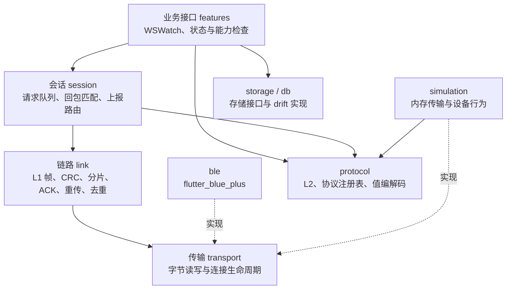
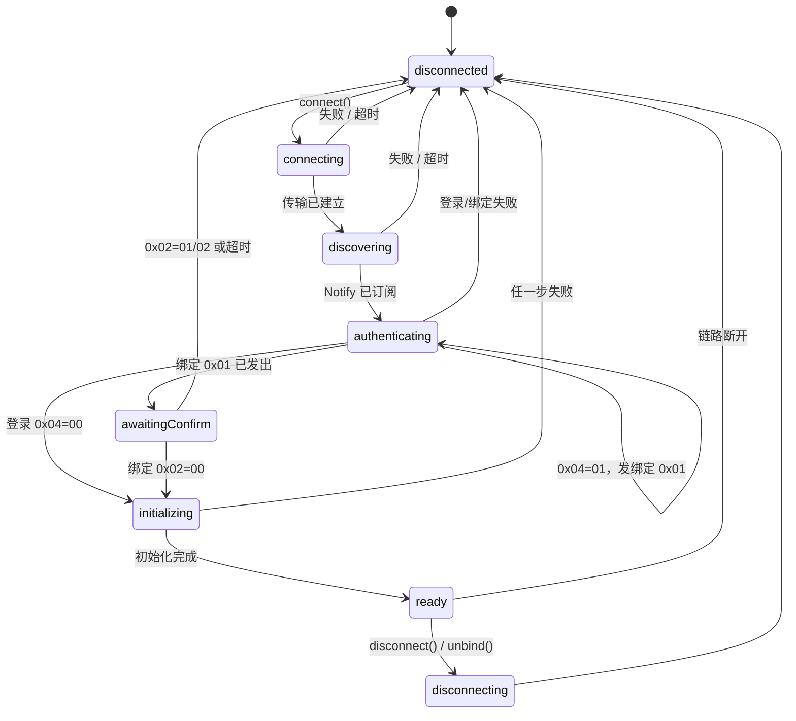
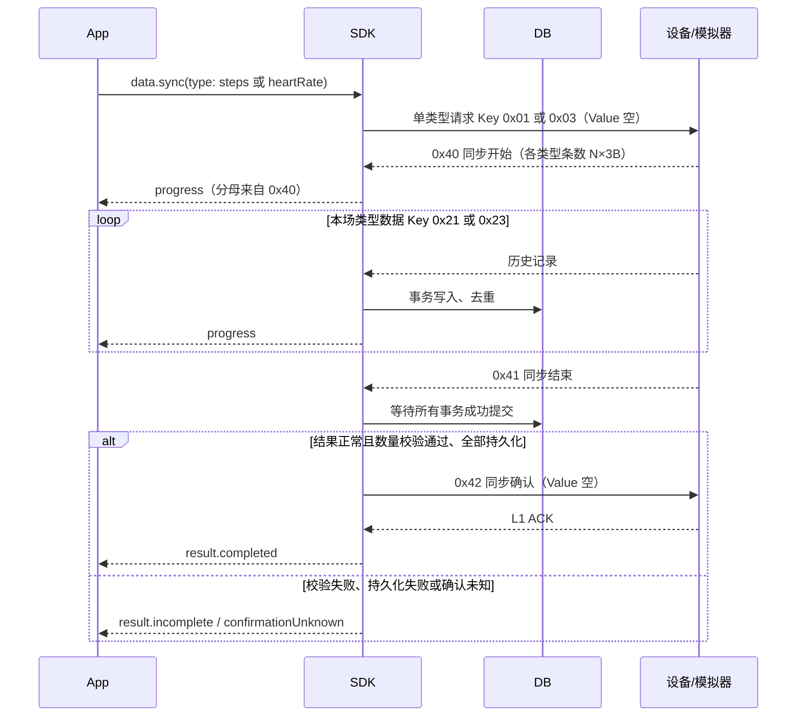

# WS Watch SDK 与 Demo 设计文档

> 状态：以 HoneyProtocol 为准，本文描述 SDK/Demo 工程与实现约定；2026-11-02 架构评审修订，新增接口为实现目标，M4 时间/语言/显示格式设置与 Demo 已实现，M3 连接与设备持久化继续保留；真实 BLE UART 连接在 M7 验收
> 范围：WS 手表 BLE SDK 的 Flutter 实现（`ws_watch_sdk`）及其 Demo（`ws_watch_demo`），在 HoneyBox 的 `packages/` 内开发；包边界清晰，将来可整体迁出
> 协议依据：[HoneyProtocol](https://realmcu.github.io/HoneyProtocol/)（仓库 `realmcu/HoneyProtocol`，下文简称**协议规范**）。条目引用格式：`0xNN` Command + Key（设置类另含**操作码**，见 `0x02-settings.rst`）
> 参考实现：Java SDK v2、HoneyBox JW 模块（`lib/services/jw/`）**仅作对照**，WS SDK 不依赖 JW 代码；JW 仍走 Realtek FF 服务，WS SDK 走协议规范的 **BLE UART Profile**（固件切换前用内置模拟设备联调）
> 联调顺序：先在**虚拟设备**上跑通连接与协议，固件就绪后同一套 SDK 连真机，仅底层传输分支不同

---

## 目录

1. [背景与目标](#1-背景与目标)
2. [总体架构](#2-总体架构)
3. [目录与文件清单](#3-目录与文件清单)
4. [蓝牙层 ble](#4-蓝牙层-ble)
5. [链路层 link 与会话层 session](#5-链路层-link-与会话层-session)
6. [协议层 protocol](#6-协议层-protocol)
7. [连接状态机](#7-连接状态机)
8. [设备能力](#8-设备能力)
9. [对外接口](#9-对外接口)
10. [数据同步](#10-数据同步)
11. [数据库](#11-数据库)
12. [错误与日志](#12-错误与日志)
13. [Demo 设计](#13-demo-设计)
14. [HoneyBox 集成](#14-honeybox-集成)
15. [测试策略](#15-测试策略)
16. [参考 HoneyBox JW 模块](#16-参考-honeybox-jw-模块)
17. [第一阶段里程碑](#17-第一阶段里程碑)
18. [待确认事项](#18-待确认事项)
19. [附录 A：v2 与 WS 接口对照（第一阶段）](#附录-av2-与-ws-接口对照第一阶段)
20. [附录 B：命名与代码约定](#附录-b命名与代码约定)

---

## 1. 背景与目标

### 1.1 背景

- 现有 Java SDK 同时存在 v1（`WristbandManager`）和 v2（`JWManager`）两套接口，历史协议多，很多功能已不再使用，也没有设备可调试。
- 协议要精简：部分协议丢弃，但编号必须保留占位，不能复用。
- 需要一个 Flutter SDK 作为基础 SDK 方案，将来可对外提供；Flutter 实现同时作为其它平台（Kotlin、Swift 等）SDK 的参考。
- 当前处于初级阶段，需要和手表固件一起联调。

### 1.2 目标

- 一个 SDK 工程（`ws_watch_sdk`）和一个 SDK Demo 工程（`ws_watch_demo`），边界清晰，将来可整体从 HoneyBox 独立出去。
- 分层清楚：业务接口 → 会话（请求、回包、上报） → 链路（组包、ACK、重传） → 传输。协议编解码与存储作为独立支撑模块，只有 BLE 实现对接 Flutter 蓝牙插件。
- 一条协议只在一处定义；丢弃的协议保留占位。
- 连接、登录、初始化由明确的状态机管理。
- SDK 内置数据库存储健康数据。
- 联调友好：收发的每一帧都可观察，可以发送任意原始命令。

### 1.3 第一阶段不做（SDK 实现范围）

- **暂不实现或仅登记占位**：`0x06` 工厂测试、`0x08` Dump Stack、`0x09` Flash 读、`0x0C`/`0x0D`/`0x10` 等未纳入 M1–M6 的命令；`0x03` 超级绑定 `0x06`/`0x07` 暂不实现，模拟器不伪造规范未定义的错误回应。
- **业务模块**：提醒、健康测量、运动、控制、通知先保留目录与 Demo 占位页；M3–M5 实现绑定、设置、历史同步子集。未实现的模块不承诺稳定的公开空类 API。
- **OTA、表盘、WiFi 配网**：不在第一阶段 SDK 范围（协议规范中部分命令已预留）。

---

## 2. 总体架构

### 2.1 工程结构

```text
HoneyBox/
├── packages/
│   ├── ws_watch_sdk/        SDK 工程（Flutter package）
│   └── ws_watch_demo/       SDK Demo 工程（Flutter package，手表相关全部界面）
└── lib/                     HoneyBox App，只负责挂载 ws_watch_demo 的入口页面
```

- `ws_watch_demo` 的业务只依赖 `ws_watch_sdk`，可使用 Flutter 与权限/文件导出辅助包，不引用 HoneyBox 的任何代码。
- HoneyBox 通过 `path` 依赖引用两个包。

### 2.2 SDK 分层

保持 `ws_watch_sdk`、`ws_watch_demo` 两个包；以下为 SDK 包内的职责划分，不为每一层另建 package。



| 模块 | 职责及允许依赖 | 不承担的职责 |
| --- | --- | --- |
| `features/` | 调用 session、protocol、storage、model；业务状态、能力检查、同步流程 | BLE 插件调用、L1 重传 |
| `session/` | 依赖 protocol、link；请求排队、回应解码与匹配、主动上报路由 | 数据库写入、功能是否可用的判断 |
| `protocol/` | 依赖纯数据 model；L2 编解码、协议地址与请求描述 | session、link、平台 API；能力枚举放 model，能力解析放 capability，避免反向依赖 |
| `link/` | 依赖 transport 接口；可靠传输 L1 payload | 解析 Command/Key、业务能力、数据库、业务上报流 |
| `transport/` | 内部连接与字节读写接口 | L1/L2、业务规则 |
| `ble/` | 实现 transport，依赖 flutter_blue_plus | protocol、features、数据库 |
| `simulation/` | 实现 transport，依赖 protocol、L1 帧编解码工具 | 导入 `test/`、features、正式数据库 |
| `storage/`、`db/` | storage 定义基于 model 的仓储接口，db 用 drift 实现 | protocol、session、link、BLE |

`WSWatch` 是组合入口，负责创建状态机、会话、各业务模块与存储句柄；内部工厂选择 BLE 或模拟传输。实现替换点保留在内部，不要求接入方选择实现类。调试门面聚合链路事件与会话协议描述，业务代码不依赖调试门面。

### 2.3 一次调用经过的路径

设置时间：

```text
watch.settings.setTime(wallClock)
  → 业务层检查 ready、设备能力，默认参数为手机当前本地年月日时分秒
  → session.send(WSSettingsProtocol.setTime, wallClock)
      → protocol 编码 4 字节墙上时钟秒
      → L2：02 00 01 00 05 00 <4 字节时间>
         Length=5，包含操作码 00 和 4 字节数据
      → link.send(payload)：加 L1 头、CRC、seq，按传输上限分片
      → transport.write；link 等待设备 ACK
  → Future 完成（表示链路确认，不保证业务设置已生效）
```

读语言：

```text
watch.settings.getLanguage()
  → session.query(WSSettingsProtocol.getLanguage)
      → 发送 02 00 03 00 01 01
      → 匹配 cmd=02、version=0、key=03、opcode=02 的读取回应
         例如 02 00 03 00 02 02 01（简体中文）
      → 解码操作数据，不把 opcode 传给语言值解码器
  → Future<WSLanguage> 完成
```

设备主动上报：

```text
Notify → transport 接收字节 → link 组包、校验、回 ACK、去重
  → session 用 protocol 解析 L2，区分读取回应与主动通知
  → 对应业务模块 Stream / 同步流程
```

---

## 3. 目录与文件清单

### 3.1 ws_watch_sdk

```text
packages/ws_watch_sdk/
├── pubspec.yaml
├── analysis_options.yaml
├── build.yaml                         drift 代码生成配置
├── lib/
│   ├── ws_watch_sdk.dart              对外导出（只导出公开 API）
│   └── src/
│       ├── watch.dart                 WSWatch：组合入口，持有业务模块、session、存储句柄、状态机
│       ├── config.dart                WSConfig：link/session/sync 参数、数据库位置、日志、模拟开关
│       ├── scanner.dart               WSScanner：扫描（模拟条目仅显式开启时加入）
│       ├── connection/
│       │   ├── connection_machine.dart    连接状态机
│       │   ├── connection_state.dart      WSConnectionState、WSConnectionStage
│       │   └── user_id.dart               WSUserId：32 字节用户 ID 生成与校验
│       ├── capability/
│       │   └── capabilities.dart          WSCapabilities：解析与查询
│       ├── features/                      业务模块
│       │   ├── settings.dart              WSSettings
│       │   ├── reminder.dart              后续模块位置，按实际实现再导出
│       │   ├── health.dart                后续模块位置，按实际实现再导出
│       │   ├── sport.dart                 后续模块位置，按实际实现再导出
│       │   ├── control.dart               后续模块位置，按实际实现再导出
│       │   ├── notify.dart                后续模块位置，按实际实现再导出
│       │   └── data/
│       │       ├── data.dart              WSData：同步入口、查询入口
│       │       ├── sync_session.dart      一次同步的流程控制
│       │       └── record_query.dart      WSRecordQuery、各类数据查询器
│       ├── protocol/
│       │   ├── address.dart               WSProtocolAddress、WSReplyAddress
│       │   ├── protocol.dart              WSProtocolEntry、WSCommand / WSQuery / WSReport
│       │   ├── registry.dart              WSProtocolRegistry：按完整地址注册、查找、冲突校验
│       │   ├── status.dart                WSProtocolStatus
│       │   ├── message.dart               L2 TLV 编解码、设置操作码封装
│       │   ├── cmd_02_settings.dart       0x02 设置（含操作码）
│       │   ├── cmd_03_bind.dart           0x03 绑定 / 登录
│       │   ├── cmd_04_notification.dart   0x04 通知
│       │   ├── cmd_05_data.dart           0x05 数据（Version 1）
│       │   ├── cmd_11_measurement.dart    0x11 点测（占位 / 后续）
│       │   └── codec/
│       │       ├── bits.dart              按位读写工具（大端）
│       │       ├── date_time_codec.dart   0x02 时间 Key 0x01 等
│       │       ├── step_codec.dart        0x05 活动 / 步数等
│       │       └── heart_rate_codec.dart  0x05 心率 Key 等
│       ├── session/
│       │   ├── session.dart               WSSession：请求队列、回应等待、generation
│       │   └── report_router.dart         L2 解码与上报路由
│       ├── debug/
│       │   ├── debug_api.dart             WSDebugApi：聚合帧观察、协议描述、Raw
│       │   └── models.dart                WSFrameEvent、WSDeviceReport、协议 Key 视图
│       ├── link/
│       │   ├── link.dart                  WSLink：L1 可靠传输、ACK、重传、帧级写入调度
│       │   ├── frame.dart                 L1 帧编解码、CRC16
│       │   ├── frame_assembler.dart       接收组包（跨多个通知）
│       │   └── frame_log.dart             WSLinkEvent：不包含协议依赖的原始帧事件
│       ├── transport/
│       │   ├── connection.dart            WSTransportConnection：内部字节传输接口
│       │   └── connection_factory.dart    内部传输工厂、测试替换点
│       ├── ble/
│       │   ├── gatt_profile.dart          UART Profile UUID
│       │   └── flutter_blue_connection.dart  真机 flutter_blue_plus
│       ├── simulation/
│       │   ├── sim_watch_session.dart     内存传输实现
│       │   └── sim_watch_device.dart      设备侧 L1/L2 行为；不导入 test/
│       ├── storage/
│       │   └── record_store.dart          内部存储接口、数据库句柄管理
│       ├── db/
│       │   ├── database.dart              drift 数据库定义、版本与迁移
│       │   ├── tables.dart                表定义
│       │   ├── device_dao.dart
│       │   ├── step_dao.dart
│       │   ├── heart_rate_dao.dart
│       │   └── sync_log_dao.dart
│       ├── model/
│       │   ├── device_info.dart           WSDeviceInfo（0x02 Key 0x30）
│       │   ├── language.dart              WSLanguage（附表 + 0x02 语言 Key）
│       │   ├── units.dart                 WSHourSystem、WSDateFormat、WSDistanceUnit、WSWeightUnit
│       │   ├── display_format.dart        WSDisplayFormat：显示格式整体 4B
│       │   ├── feature.dart               WSFeature、WSFeatureSupport（纯枚举）
│       │   ├── frame.dart                 收发方向、帧事件种类（纯枚举）
│       │   ├── step_record.dart
│       │   ├── heart_rate_record.dart
│       │   ├── sync.dart                  WSSyncProgress、WSSyncResult、WSHistoryType
│       │   └── wall_clock.dart            WSWallClock：设备本地时间
│       ├── errors.dart                    WSException 及子类
│       └── logger.dart                    WSLogger
└── test/
    ├── sim/
    │   └── scenarios.dart                 场景脚本与故障注入配置，调用 lib/src/simulation
    ├── vectors/                           与 HoneyProtocol 示例 hex 对齐的 JSON
    ├── protocol/
    ├── link/
    ├── session/
    ├── connection/
    ├── features/
    └── db/
```

### 3.2 ws_watch_demo

```text
packages/ws_watch_demo/
├── pubspec.yaml
└── lib/
    ├── ws_watch_demo.dart             对外导出：WSWatchDemoApp、WSWatchDemoHome
    └── src/
        ├── demo_app.dart              WSWatchDemoApp（完整 MaterialApp，独立运行时使用）
        ├── demo_home.dart             WSWatchDemoHome（可嵌入宿主 App 的入口页面）
        ├── demo_scope.dart            DemoScope：持有 WSWatch 实例（InheritedWidget）
        ├── run_action.dart            统一执行 SDK 调用并展示结果
        ├── scan/
        │   └── scan_page.dart
        ├── home/
        │   ├── device_home_page.dart
        │   ├── connection_stage_view.dart
        │   └── module_grid.dart
        ├── settings/
        │   └── settings_page.dart
        ├── data/
        │   ├── sync_page.dart
        │   └── records_page.dart
        ├── reminder/  health/  sport/  control/  notify/   第一阶段为占位页
        ├── debug/
        │   ├── debug_panel.dart           悬浮入口
        │   ├── frame_log_page.dart
        │   ├── raw_send_page.dart
        │   ├── protocol_table_page.dart
        │   └── device_reports_page.dart
        └── widgets/
            ├── result_card.dart
            ├── hex_view.dart
            ├── capability_gate.dart
            └── form_fields.dart
```

---

## 4. 蓝牙层 ble

SDK 使用同一条业务连接路径：`WSWatch.connect(deviceId)` → 内部传输工厂 → `WSTransportConnection` → `WSLink`。正式 BLE 和模拟传输只在工厂及底层实现处分支。

### 4.1 GATT（L0，协议规范）

| 项 | UUID | 用途 |
| --- | --- | --- |
| UART Profile Service | `6e400001-b5a3-f393-e0a9-e50e24dcca9e` | 协议服务 |
| Write Characteristic | `6e400002-b5a3-f393-e0a9-e50e24dcca9e` | App → 设备，带响应写 |
| Notify Characteristic | `6e400003-b5a3-f393-e0a9-e50e24dcca9e` | 设备 → App（Notification） |

Phone 端 Write 发送、Notify 接收，与 JW 模块的 FF02/FF03 服务独立。固件尚未切换 UART 时使用模拟设备。

### 4.2 内部传输接口

```dart
abstract interface class WSTransportConnection {
  String get deviceId;
  int get maxWriteLength;                 // BLE 为当前 MTU - 3
  Stream<Uint8List> get received;
  Stream<void> get disconnected;
  Future<void> prepare();                 // BLE：发现服务并订阅 Notify
  Future<void> write(Uint8List chunk);     // 单次不超过 maxWriteLength
  Future<void> disconnect();
  Future<void> dispose();                 // 释放订阅，幂等
}
```

连接建立由内部工厂完成。订阅断开事件、准备服务和创建 Link 的顺序须避免漏掉早到通知；准备失败必须释放连接。内部测试可替换工厂，无须向普通接入方暴露 BLE 插件类型。

`WSScanner` 返回 SDK 自己的设备描述（deviceId、名称、RSSI、广播数据），具有停止扫描和幂等释放操作。扫描与连接共享相同模拟配置；扫描页退出时停止扫描，设备页退出时按 Demo 生命周期断开连接。

### 4.3 真机实现要点

- Android 连接后请求 MTU 247；iOS 由系统协商，Link 使用当前有效写入上限，不硬编码 244。
- `prepare` 必须找到 UART 三 UUID 并完成 Notify 订阅，否则抛出 `WSConnectException(stage: discovering)`。
- BLE 单次 write 不维护业务队列；所有数据帧与 ACK 帧由 Link 的同一个写入调度器串行发送。
- 扫描默认不过滤 Service UUID；名称、厂商数据等识别策略与 JW 独立。设备地址作为平台连接标识，不假定在所有平台永久稳定。
- Windows 补丁由宿主 App / 独立 example 的依赖配置提供；发布前须验证脱离 HoneyBox 的依赖解析与构建。

### 4.4 虚拟设备

**默认关闭。** Demo 显式提供 `WSConfig(simulationEnabled: true)`，并将该配置同时用于 `WSWatch.scanner(config: config)` 与 `WSWatch(config: config)`。开启后扫描列表增加模拟条目，即使 BLE 关闭或无权限也可使用；真实扫描失败单独展示，不阻止模拟设备使用。

| 约定 | 值 |
| --- | --- |
| 固定 ID | `kWsWatchSimDeviceId = 'ws-watch-sim'` |
| 广播名称 | `WS Watch Simulator` |
| 路由规则 | 仅模拟模式开启且 ID 精确匹配时使用模拟传输；不根据真实广播名称切换 |

`lib/src/simulation/sim_watch_session.dart` 实现传输接口，内部持有同目录的 `SimWatchDevice`，实现设备侧 L1 接收、ACK 和 L2 行为。正式 `lib/` 不导入 `test/`。测试脚本和故障注入配置放在测试目录，通过内部测试工厂接入；不增加面向普通接入方的故障注入 API。

模拟器支持 `bound / need_bind / empty_sync` 等场景，以及丢 ACK、ERR ACK、迟到回应、断链。默认数据来自规范示例，但规范 JSON 向量须独立核验，不以模拟器输出作为唯一正确性依据。模拟通过代表软件流程通过，真机验收仍是 M7 的必要条件。

---

## 5. 链路层 link 与会话层 session

### 5.1 帧格式及责任

与 `architecture.rst` 一致，大端。Link 只读写 L1 payload；L2 编解码由 protocol 提供，会话层调用。

| L1 字段 | 说明 |
| --- | --- |
| Magic | `0xAB` |
| Flags | Version=0；ACK bit4、ERR bit5 |
| Payload length | 16 bit，最大 65535 B；实际发送上限还受固件缓冲限制 |
| CRC16 | CRC-16/ARC，仅覆盖 payload |
| Sequence ID | 16 bit；ACK 使用被确认数据帧的 seq |

L1 头共 8B；Success / Error ACK 的 payload 长度为 0。L2 头为 Command 1B + Version/Reserve 1B（`0x05` Version 1 为 `05 10`）；后面为 Key 1B + Length 2B + Value。`0x02` 的 Value 首字节为操作码，Length 包含该操作码。接收支持单包多 Key。

### 5.2 参数

| 参数 | 默认值 | 所属及语义 |
| --- | --- | --- |
| `ackTimeout` | 5 秒 | `WSConfig.link`：完整帧全部写出后等待 ACK |
| `maxRetries` | 3 | `WSConfig.link`：ERR ACK / ACK 超时后的整帧重发次数，同 seq |
| `chunkWriteTimeout` | 3 秒 | `WSConfig.link`：单次传输 write 超时 |
| `rxAssembleTimeout` | 5 秒 | `WSConfig.link`：接收分片之间最长间隔 |
| `maxPayloadLength` | 65535 B | `WSConfig.link`：L1 收发长度上限；可按固件限制调低 |
| `replyTimeout` | 5 秒 | `WSConfig.session`：ACK 后等待回应；请求可覆盖，绑定使用 §7 的确认超时 |
| `queueCapacity` | 64 | `WSConfig.session`：待发送业务请求上限，不含内部 ACK |

协议字段允许 65535B，不代表固件一定接受；真机联调确定产品限制后设置配置。总接收缓冲有界，头部版本、flags、长度须先校验。

### 5.3 Link 发送与 ACK 调度

1. Link 为数据帧分配 seq（每次连接从 1 开始，16 bit 回绕），在首次 write 前登记 ACK 等待器，避免漏掉早到 ACK。
2. 按 `maxWriteLength` 分片，使用同一写入调度器逐片发送。**一个完整 L1 帧是不可交错的发送单元**，中间不得插入 ACK 或其他数据帧。
3. 设备数据帧需要的 ACK 不进入业务请求队列；当前完整帧写完即可优先发送，不等待当前业务请求的 ACK 或 L2 回应。
4. 收到匹配 seq 的 Success ACK 后完成 L1 发送；ERR ACK / ACK 超时按配置重发完整帧，超过次数后失败。非幂等命令可通过请求描述覆盖 maxRetries，解绑第一阶段为 0。
5. 分片 write 失败可能留下对端半帧，第一阶段按链路不可恢复处理：终止连接并使待处理请求失败，不立即在同一字节流重发完整帧。
6. L1 只保证帧交付；业务设置是否生效不由 ACK 保证。设备侧对重传的去重行为须纳入固件验收，非幂等操作不能仅凭 SDK 重试策略保证只执行一次。

### 5.4 Link 接收与去重

- 未找到 magic 时逐字节寻找；不完整帧等待后续通知，超时清空当前不完整帧。
- 仅在合法头部及可信 seq 已完整取得时，才可针对组包超时回 ERR ACK；不足以识别 seq 时直接丢弃并记录事件。
- 完整数据帧先校验 CRC，错误则回 ERR ACK；合法帧回 Success ACK，再交付 payload。
- 每条连接维护有界的近期接收缓存（默认最近 64 帧、保留 30 秒），以 seq 和完整 payload 判断重复。重复只 ACK、不再次交付；相同 seq 不同 payload 不直接当作重复，记录异常事件。缓存随断开清空，seq 回绕不采用永久去重集合。
- L1 ACK 独立路由，不进入 L2 解码。接收数据不等待当前查询结束，持续向 Session 交付。

### 5.5 Session 请求与回应

业务与调试请求共享 FIFO 队列，一次只执行一个请求；从入队到完成均绑定当前连接 generation。

1. 在发送前注册回应等待器；protocol 只编码一次操作码。Command 等 L1 ACK；Query 同时等待 L1 发送结果与符合 `replyAddress` 的回应。
2. 回应按 Command、Version、Key、操作码、方向匹配；主动通知操作码 `03` 不完成读取回应操作码 `02` 的查询。匹配器可以增加业务字段条件。
3. 回应可以早于 ACK，先缓存结果，但不凭业务回应推断 L1 seq 已确认；ACK 最终失败时请求仍失败。当前协议未承诺请求与回应 seq 相等。
4. ACK 成功后启动回应超时；已有早到回应则立即完成。匹配地址但值解码失败，以 `WSProtocolDecodeException` 结束该请求；不误报为普通超时。
5. Command 完成后处理下一项；Query 在回应成功或失败后才推进。绑定请求覆盖默认回应超时，等待用户确认。

**串行不等于能识别迟到回应。** 当前 L2 没有请求 ID。第一阶段 Query 的 ACK 或回应超时后，立即终止当前连接并使队列以会话失效异常失败；重建连接并完成初始化后才接受新请求。断开、取消连接或 dispose 都使旧 generation 失效，旧订阅与回调不能影响新会话。普通业务请求不自动跨重连重放。

这种策略隔离 SDK 内的旧连接事件，但仍需固件在断链时清理旧回应/同步任务；若固件跨连接保留任务，必须补充协议关联 ID 或明确终止机制，不能宣称已完全解决串单。后续若加入请求 ID，再评估同类请求重试或并发。

### 5.6 Session 上报路由

Session 用 protocol 解析 L2，按完整地址逐 Key 路由：

1. 符合当前 Query 回应地址：解码并完成/缓存该回应。
2. 已登记的主动通知：解码并发到对应上报流，业务模块自行订阅。
3. 已废弃、暂未实现、保留或未知地址：保留原始字节与状态，发到调试事件流。
4. 无等待者的读取回应标为 unsolicited reply，不伪装成主动通知。

值解码失败记录错误并继续处理其他 Key；若 TLV 长度本身损坏、无法确定下一 Key 边界，则停止解析该 L2 包，保留原始包。不能无条件承诺继续后续 Key。

### 5.7 帧观察与调试门面

`WSLink`、Session、可执行协议条目均为内部实现。公开 `watch.debug` 提供只读事件与受控原始发送。

```dart
abstract interface class WSDebugApi {
  Stream<WSFrameEvent> get frames;
  Stream<WSDeviceReport> get reports;
  List<WSProtocolView> get protocols;       // 只读描述，不暴露可执行内部对象
  Future<T> trace<T>(String traceId, Future<T> Function() action);
  Future<Uint8List?> sendRaw(WSRawRequest request);
}

class WSRawRequest {
  final int cmd, version, key;
  final int? settingOpcode;                // cmd=02 必填，其余为 null
  final Uint8List data;                    // 仅操作数据，不再包含操作码
  final WSReplyAddress? replyAddress;      // cmd/version/key/opcode/方向
  final Duration? replyTimeout;
}
```

Session 根据 `settingOpcode + data` 生成 Value、计算 Length。Raw 也必须经过同一队列、超时隔离和地址校验；已登记地址沿用非幂等命令的重试限制，未知/未实现地址默认不自动重试；只允许已完成传输准备的当前会话使用，连接认证/初始化期间拒绝外部 Raw，防止干扰流程。就绪后的 Raw 可绕过业务能力检查以便联调，但不能发送 dropped/reserved 地址；unimplemented 地址允许显式 Raw。原始回包返回剥离操作码后的操作数据，详细报文看 frames。

`WSReplyAddress` 是公开的只读回应地址，包含 cmd/version/key/settingOpcode/direction，direction 必须为 deviceToPhone；内部匹配器再转换为协议地址。以上代码为接口示意，省略构造器。

`WSFrameEvent` 包含 time、connectionGeneration、可空 traceId/requestId、direction、kind、可空 seq、raw、可选 Key 描述。完整帧事件的 raw 是完整帧，chunk/错误事件仅含当时可取得的字节。协议名称由调试门面结合注册表补充，Link 不依赖注册表。traceId 可通过调试门面的 `trace<T>(String traceId, Future<T> Function() action)` 按异步调用上下文传入；traceId/requestId 只用于 SDK 观测，不代表协议新增关联字段；并发上报不自动算作当前请求的回应。

### 5.8 断开与释放

当前请求和待处理请求失败；清空 ACK/回应等待器、接收缓冲、去重记录与定时器，取消旧订阅。主动断开、解绑、dispose 取消重连任务；dispose 幂等且之后所有操作明确失败。连接失败也执行同一清理流程。重连使用新的 generation 和 seq。

---

## 6. 协议层 protocol

### 6.1 地址、请求描述与状态

区分「线上的协议地址」和「一次调用的请求描述」。同一 Key 的读取、设置、回应、通知属于不同地址；一份值编解码器可以由多个地址复用。

```dart
enum WSProtocolStatus {
  active,          // 规范已定义，SDK 已实现
  unimplemented,   // 规范已定义，SDK 尚未实现
  dropped,         // 规范明确废弃，编号不能复用
  reserved,        // 规范保留编号，尚未定义
}

enum WSWireDirection { phoneToDevice, deviceToPhone }

class WSProtocolAddress {
  final int cmd, version, key;
  final int? settingOpcode;                // 02：00/01/02/03 等；其他命令 null
  final WSWireDirection direction;
}

class WSProtocolEntry {
  final WSProtocolAddress address;
  final String name, specRef;
  final WSProtocolStatus status;
  final WSFeature? requires;
  final String? reason;
  final bool factoryOnly;                  // 使用场景标签，与实现/废弃状态分开
}

// 以下类型为内部调用描述，构造器等省略。
class WSCommand<T> {
  final WSProtocolEntry request;
  final Uint8List Function(T value) encodeData;
  final int? maxRetries;                   // 可覆盖默认；解绑等非幂等操作为 0
}

class WSQuery<T, R> {
  final WSProtocolEntry request;
  final WSProtocolEntry reply;
  final Uint8List Function(T value) encodeData;
  final R Function(Uint8List data) decodeData;
  final Duration? replyTimeout;
}

class WSReport<T> {
  final WSProtocolEntry entry;
  final T Function(Uint8List data) decodeData;
}
```

`encodeData/decodeData` 仅处理操作数据。`protocol/message.dart` 统一拼装/剥离设置操作码，计算包含操作码的 Length；`0x03` 等非设置命令不添加操作码。Version 是地址与编码参数，不在 Link 中按 Command 硬编码。

### 6.2 注册表

- 各章定义协议条目，由 `registry.dart` 汇总。按完整 `(cmd, version, key, settingOpcode, direction)` 校验唯一性；请求描述通过引用复用同一回应条目，不重复注册。
- dropped/reserved 地址禁止重新定义；明确废弃的整个 Key/Command 还需以范围占位约束其全部子地址。暂未实现不等于废弃，不能用 dropped 代替版本实现进度。
- `lookup(address)` 用于精确分发；`listByCommandKey` 用于 Demo 浏览，不能用模糊查找完成 Query。
- WSReport 与 WSQuery 可复用同一个值解码器；同一入站地址存在多种用途时，由 Session 按等待者及条目用途路由，而非重复登记。
- 构建冲突直接失败，由测试校验；注册表只描述协议，不读取当前连接、能力或数据库。

### 6.3 设置协议示例

功能列表读取：请求地址为 `(02, version=0, key=31, opcode=01, phoneToDevice)`，回应地址为同 Key、`opcode=02`、`deviceToPhone`。

```text
请求：02 00 31 00 01 01
回应：02 00 31 00 11 02 <16 字节位图>
```

请求 `encodeData` 返回空字节；回应 `decodeData` 只接收 16 字节位图，由 capability 模块构造能力对象。语言 Key `03` 的设置、读取、回应和通知分别登记 opcode `00/01/02/03`，读取回应与通知复用语言编码解码器。

### 6.4 第一阶段核心条目

| Command / Version | 请求与回应 | 说明 |
| --- | --- | --- |
| 03 / 0 | Key 03 → 04 | 登录；00 成功，01 需绑定 |
| 03 / 0 | Key 01 → 02 | 绑定；00 成功、01 超时、02 拒绝；覆盖回应超时 |
| 03 / 0 | Key 05 | 解绑；Value 为预留 1B `00`，仅 L1 ACK |
| 02 / 0 | Key 01，opcode 00 | 4B 墙上时钟秒；通知 opcode 03 |
| 02 / 0 | Key 02，opcode 00 | 手机系统；Android=02，iOS=01；桌面取值见待确认事项 |
| 02 / 0 | Key 03，opcode 00/01/02/03 | 语言设置、读取、回应、通知 |
| 02 / 0 | Key 04，opcode 00/01/02/03 | 显示格式，整体 4B |
| 02 / 0 | Key 30、31，opcode 01 → 02 | 设备信息、128 bit 功能列表 |
| 05 / 1 | Key 01、03；后续扩展 00 等 | M5 先分别同步活动和心率；00 全量暂不开放，避免未支持类型被确认 |
| 05 / 1 | Key 40、21/23、41、42 | 开始、活动/心率数据、结束、持久化确认 |
| 11 / 0 | 暂未实现 | 点测与历史同步独立，后续扩展 |

未实现的规范地址标 unimplemented；未知地址保留原始字节展示，不中断链路。不得为模拟器随意发明规范未定义的“不支持”回应，未实现场景通过明确测试行为或超时验证。

### 6.5 编解码与测试向量

- `WSBits` 仅用于规范实际存在的位域，不套用旧协议时间位域。
- `WSDateTimeCodec` 编解码 4B 无符号墙上时钟秒，检查范围、日期与无效值；不做隐式时区换算。
- 历史数据按单条长度与条数解析；校验长度、溢出及无效值，允许规范约定的尾部扩展，保留原始字节。
- JSON 向量保存规范来源、协议地址、输入与期望结果，供跨语言复用；期望字节来自规范或独立抓包，不由待测编码器生成。

---

## 7. 连接状态机

### 7.1 状态

```dart
enum WSConnectionState {
  disconnected,
  connecting,
  discovering,     // 发现 UART 服务、订阅 Notify
  authenticating,  // 0x03 登录 / 0x01 绑定
  awaitingConfirm, // 已发绑定 0x01，等待手表确认（0x02 回包）
  initializing,    // 0x02：手机系统、对时、功能列表、设备信息
  ready,
  disconnecting,
}
```

`WSWatch.state` / `stateChanges` 供 Demo 展示各阶段耗时；任一步失败抛出 `WSConnectException`（含 stage 与 reason）。

### 7.2 流程

与 `0x03-bind.rst` 规则一致：



初始化顺序（规范：绑定规则第 2 点）：内部初始化命令由状态机调用 Session，不受外部业务接口的 ready 门禁限制。

1. `0x02` 手机系统（Key `0x02`，操作码设置）；
2. `0x02` 对时（Key `0x01`）；
3. `0x02` 读功能列表（Key `0x31`，操作码读取 → 回应操作码 `0x02`）；
4. `0x02` 读设备信息（Key `0x30`）；
5. 写入本地 `devices` 表，成功后进入 ready；初始化失败清理连接与未完成请求。

绑定等待：手表侧确认超时 + 5s（规范）；SDK `awaitingConfirm` 默认 60s 可配置，应 ≥ 固件确认窗口 + 5s。绑定 Query 的 replyTimeout 必须使用该值，不能仍使用通用 5s；状态机阶段计时与 Query 计时使用同一截止时间。

### 7.3 超时

| 阶段 | 默认值 | 说明 |
| --- | --- | --- |
| connecting | 15 秒 | |
| discovering | 10 秒 | |
| authenticating | 每个请求按链路默认 | 登录 / 绑定 |
| awaitingConfirm | 60 秒 | 等待用户在手表上确认，可配置 |
| initializing | 每个请求按链路默认 | |

### 7.4 重连

- `WSConfig.autoReconnect`（默认关闭）。开启后，非主动断开时按 2 秒、4 秒、8 秒……最长 60 秒退避重连。
- 重连必须完整走一遍 connecting → … → ready，不存在"连上但未登录"的中间可用状态。这修复了修复清单 N05 的问题。
- 主动 `disconnect()` 或 `unbind()` 之后不会自动重连。

### 7.5 生命周期与非就绪状态

- 同一实例并发 `connect` 拒绝后来的调用，不静默切换设备；先 disconnect 再连接其他设备。
- connecting/discovering/authenticating/awaitingConfirm/initializing 任一阶段都可 disconnect；取消阶段定时器与等待器，旧异步结果通过 generation 检查失效。
- disconnect/dispose 幂等，必须停止扫描之外的实例订阅、请求、同步任务与自动重连；扫描器由其创建方独立 dispose。
- unbind 仅在 ready 执行，发送 `03 00 05 00 01 00` 并等 ACK 后断开；ACK 丢失时报告结果未知并仍断开，后续通过登录确认，不自动重发解绑。
- 默认用户 ID 在首次认证前持久化，devices 的设备信息字段允许尚未初始化时为空；认证完成后更新最近成功登录 ID，不能因初始化失败丢失已经用于绑定的默认 ID。

### 7.6 业务接口在非就绪状态下的行为

需要设备通信的业务接口仅在 `ready` 下接受调用，否则立即抛出 `WSNotReadyException`，不排队等待。已打开数据库的本地查询/删除可在 disconnected 状态使用；dispose 后所有操作均拒绝。

### 7.7 用户 ID

- 线上字段固定 32 字节。`WSUserId` 接受 1～32 字节非 NUL ASCII 字符串，编码时右侧补 `0x00`；拒绝超长、非 ASCII 和嵌入 NUL。默认自动生成 32 位十六进制字符串，数据库保存补零前的规范字符串。
- `connect(device, userId: ...)` 由接入方传入（与 v2 相同）。如果不传，SDK 先使用数据库中该设备上次登录用的 ID；没有则生成一个随机 ID（32 位十六进制字符），并保存到设备表。
- 同一设备换 ID 登录会触发重新绑定。Demo 明确展示当前 ID 与来源（接入方传入/SDK 默认）；SDK 默认 ID 仅作无账号接入的便捷策略，卸载重装或跨手机不保证保留，账号产品应由接入方稳定提供。

---

## 8. 设备能力

### 8.1 功能列表（0x02 Key 0x31）

功能列表为 **16 字节 / 128 bit**，bit 分配仍待规范确认。`WSCapabilities` 保留完整 raw 与所有未知位；未定义 bit 在 Demo 显示为「保留」，不得擅自推断功能含义。

```dart
enum WSFeatureSupport { supported, unsupported, unknown }

class WSCapabilities {
  final Uint8List raw;
  WSFeatureSupport supportOf(WSFeature feature);
}
```

### 8.2 能力检查

- 业务模块根据当前设备能力检查声明的 `requires`；明确 unsupported 时抛 `WSUnsupportedException`，不发送。
- 未定义映射、缺少能力版本依据时返回 unknown。第一阶段允许 unknown 功能按已定义协议尝试调用，Demo 显示“能力未确认”，不能等同于支持或不支持。
- 能力检查在 features / 业务执行器统一完成；Session 与 Link 不读能力对象。`watch.debug.sendRaw` 允许绕过能力门禁，但保留地址状态和会话约束。
- 模块提供三态能力查询，例如 `watch.settings.languageSupport`；只有明确 unsupported 灰显。未实现功能由 SDK 实现状态单独灰显，避免混用设备能力与 SDK 进度。

### 8.3 通知与扩展

设置类 opcode 03 为主动通知，和 opcode 02 读取回应分别登记。未知通知保留原始地址和数据，不阻断连接。协议版本、能力 bit 分配确认后更新映射与测试向量；不根据固件版本字符串随意猜测能力。

---

## 9. 对外接口

### 9.1 入口

`WSConfig` 包含 `link`（ACK/重传/组包）、`session`（请求队列/回应超时）、`sync`（同步空闲超时/待写缓冲）、`connectTimeouts`、`autoReconnect`、`databasePath`、`logger/logLevel` 与 `simulationEnabled`（默认 false）。各参数在所属模块消费；M1 中原先放在 link 的 replyTimeout、queueCapacity 已随 M2 Session 实现迁移。

```dart
class WSWatch {
  WSWatch({WSConfig config = const WSConfig()});

  static WSScanner scanner({WSConfig config = const WSConfig()});

  WSConnectionState get state;
  Stream<WSConnectionChange> get stateChanges;

  Future<void> connect(String deviceId, {String? userId});
  Future<void> disconnect();
  Future<void> unbind();                 // 0x03 Key 0x05，然后断开

  WSDeviceInfo? get deviceInfo;          // 就绪后可用
  WSCapabilities? get capabilities;      // 就绪后可用
  String? get userId;

  WSSettings get settings;
  // reminder / health / sport / control / notify 在实际实现时再加入公开 API。
  WSData get data;

  WSDebugApi get debug;                  // 帧观察、协议描述、受控原始发送

  Future<void> dispose();                // 断开、释放订阅和存储引用，幂等
}
```

每台设备一个 `WSWatch` 实例；多台设备可创建多个实例，同一路径共享数据库。同一进程内同一真实 deviceId 只允许一个活动连接，重复连接明确失败。

### 9.2 settings（第一阶段）

```dart
class WSSettings {
  Future<void> setTime([WSWallClock? time]);     // 默认手机当前本地年月日时分秒
  Future<void> setLanguage(WSLanguage language);
  Future<WSLanguage> getLanguage();
  Future<WSDisplayFormat> getDisplayFormat();
  Future<void> setDisplayFormat(WSDisplayFormat value);

  Future<void> setHourSystem(WSHourSystem value);
  Future<WSHourSystem> getHourSystem();
  Future<void> setDistanceUnit(WSDistanceUnit value);
  Future<WSDistanceUnit> getDistanceUnit();

  WSFeatureSupport get languageSupport;
  WSFeatureSupport get displayFormatSupport;
  WSSettingsSnapshot get observed;       // 仅设备读取/通知值，断开后清空
  Stream<WSSettingsSnapshot> get changes; // dispose 时关闭
}
```

- `WSDisplayFormat` 包含时制、日期格式、距离单位、体重单位，对应 Key `04` 的完整 4B，保留未知字段编码。
- 单字段 setter 是便利方法，内部串行执行“读取完整值 → 替换一个字段 → 写入完整值”，整个过程作为同一业务临界区，多个 setter 与整体设置不能互相覆盖。读取失败则不写，不能用默认值补齐其他字段。
- 设备通知更新观察值，但临界区无法保证与手表端同时修改的原子性；当前协议没有用于条件更新的版本号，最终以重新读取为准。Demo 提供整体设置页，清楚展示本次完整写入值。
- 写操作 Future 成功只表示 L1 ACK；需要确认生效时主动读取支持读取的设置。时间只写与通知，不提供不存在的读时间接口。
- `WSLanguage` 覆盖规范 `00～66`，`67～FF` 保留；语言、时制、日期、距离、体重使用带 `code / isKnown` 的值对象，未知编码完整保留。DateTime 转 WSWallClock 时必须显式选择本地年月日时分秒；不把墙上时钟当作绝对 UTC 时刻。

### 9.3 data（第一阶段）

```dart
class WSData {
  bool get isSyncing;

  /// 发起同步。同一时刻只允许一个同步，重复调用抛 WSSyncInProgressException。
  WSSyncSession sync({required WSHistoryType type}); // M5 仅 steps / heartRate

  WSRecordQueryApi<WSStepRecord> get steps;
  WSRecordQueryApi<WSHeartRateRecord> get heartRate;
}

class WSSyncSession {
  Stream<WSSyncProgress> get progress;   // 广播流；返回 session 后再异步开始流程，避免漏首事件
  Future<WSSyncResult> get result;       // completed / incomplete / confirmationUnknown
  Future<void> cancel();
}

class WSRecordQueryApi<T> {
  Future<List<T>> query(WSRecordQuery query);
  Future<int> delete(WSRecordQuery query);
}

class WSRecordQuery {
  final String deviceId;                 // 必填
  final String? userId;                  // 为空表示不限
  final WSWallClock? from;               // 含
  final WSWallClock? to;                 // 不含
  final int? limit;
  final bool descending;
}
```

### 9.4 其它模块

`reminder`、`health`、`sport`、`control`、`notify` 第一阶段只保留内部目录与 Demo 占位页，不提前导出空类。业务实现完成后再加入 `WSWatch` 公开 API。实时类数据统一以 `Stream` 提供，例如以后的 `watch.health.realtimeHeartRate`。

模块归属规则：**看它影响的是什么，而不是用什么命令实现**。例如自动心率监测开关影响健康数据采集，归 `health`；温度单位影响显示，归 `settings`。

---

## 10. 数据同步

与 `0x05-data.rst` 一致（L2 Header **Version 1**：`05 10`）。

### 10.1 流程（历史同步）



运动详情 `0x80`/`0x81`、今日 Key `0x60`～ 等在后续里程碑实现；主同步与 `0x11` 点测分离。

### 10.2 规则

- **M5 子集**：先分别实现活动请求 `01` → 数据 `21` 和心率请求 `03` → 数据 `23`。不开放全量 `00`，直至请求范围内全部类型均支持持久化，避免丢弃未实现类型后发送全场确认。
- **顺序**：`0x40` → 数据 Key（升序，同 Key 可多帧）→ `0x41` → 手机 `0x42`。数据处理和 DB 写入有序；进度中的有效实收、已提交、新增、重复分别计数，L1 重传不重复计数。
- **完成条件**：收到 `0x41` 结果 `00`，按类型有效实收数量与 `0x40` 声明一致、总数与 `0x41` 一致，无解码丢失或数据库失败，全部事务提交成功后才发 `0x42`。重复记录也计入有效实收，新增数不能替代实收数。
- **失败结果**：`0x41` 的 `02/03/04` 分别为忙、失败、参数错误；不发 `0x42`。数据库失败、未知类型、数量不符也不确认，返回 incomplete，保存已提交记录与原因。
- **确认阶段**：`0x42` ACK 成功才返回 completed；写出后 ACK 丢失/断链返回 confirmationUnknown，表示本地持久化成功、设备是否标记已同步未知；不宣称设备一定未处理。后续重同步依靠去重恢复。
- **去重**：设备和用户范围内，健康按「类型 + 时间戳」、运动摘要按 sport_id；不同来源/质量冲突时采用明确规则，M5 相同键按最新有效记录覆盖，无效值不覆盖已有有效值。
- **互斥**：同一设备最多一场历史同步或运动详情；同步控制命令不允许 Raw 并发插入。同步期间其他设置请求可按 Session 队列正常执行，入站历史数据持续处理。
- **空闲超时**：默认 30s 无同步数据进入 incomplete，已提交数据保留。`WSConfig.sync` 默认 syncIdleTimeout=30s、maxPendingBytes=1MiB，按待持久化原始 payload 字节计量。缓冲溢出终止同步，不确认；以真机压力测试结果调整配置。
- **断开 / cancel / 超时**：不再发送本场 `0x42`；关闭当前连接以隔离后续同步数据，等待已开始的事务完成后返回部分结果。`cancel()` 幂等，结果记录 cancelled。设备当前没有明确取消 Key，不能只取消本地监听后立刻复用同一连接开始下一场。
- **代际隔离**：每场同步绑定 connection generation 与本地 syncId，记录的 userId 在开始时固定；旧回调不归入新会话。固件须断链终止旧同步，否则需要协议级 syncId/终止机制（见 Q7）。
- **日志**：记录声明数、有效实收/提交/新增/重复/解码失败数、设备结束码、持久化结果与确认状态。预期的取消、断链、同步失败通过 result 表达；参数非法、未就绪、重复发起同步在入口明确报错。

### 10.3 存储字段

记录时间戳为 **1970 起墙上时钟秒**（与设备显示一致，不做时区换算）；无效值规则见 `0x05-data.rst`。

---

## 11. 数据库

### 11.1 选型

`drift`（SQLite），由 `drift_flutter` 的平台集成初始化数据库；原生 SQLite 的打包方式以锁定依赖版本为准，不在设计中重复指定另一套原生库依赖：

- 支持 Android、iOS、Windows、macOS；`sqflite` 不支持 Windows。
- 类型安全，带版本迁移机制。
- 需要 `build_runner` 生成代码，只在 `ws_watch_sdk` 包内使用，不影响 HoneyBox。

### 11.2 位置与配置

- 默认文件：应用支持目录下的 `ws_watch.db`。
- `WSConfig.databasePath` 可覆盖；内部测试工厂显式创建独立内存库，不能将全部内存测试共享为一个全局连接。
- 存储管理器按规范化后的绝对数据库路径共享连接，路径不同使用不同连接。并发首次打开须合并为同一次初始化；每个 WSWatch 持有引用，最后一个引用释放后关闭。
- db 实现内部 storage 接口，业务模块不依赖 drift 类型；第一阶段默认必须有内置存储，不新增多个存储 package，也不承诺公开可插拔后端。
- `WSWatch` 构造器不进行异步 I/O；首次 connect/本地 query/delete 时打开数据库，失败通过对应 Future 返回。dispose 等待本实例写入收尾并释放引用，不关闭其他实例仍在使用的库。

### 11.3 时间的存储

设备上报 4B 墙上时钟秒，没有时区信息。

- `recordTime`：设备本地时间按"墙上时间"编码成整数秒，即把年月日时分秒当作 UTC 换算出的秒数。不做任何时区换算，查询也按同样的方式比较。
- `tzOffsetMinutes`：同步时手机的时区偏移，仅为同步环境元数据；不代表历史记录发生时的偏移，无法据此可靠还原跨时区或夏令时的绝对时间。
- 对外统一使用 `WSWallClock`（年、月、日、时、分、秒），避免 `DateTime` 隐式时区带来的问题。

### 11.4 表结构（schemaVersion 1）

`devices`：

| 列 | 类型 | 说明 |
| --- | --- | --- |
| deviceId | TEXT 主键 | Android 为 MAC；iOS 为系统 UUID，就绪后若设备信息中有 BT MAC 则另存 |
| btMac | TEXT 可空 | 0x02 设备信息中的 MAC |
| name | TEXT | 广播名 |
| userId | TEXT | 默认/最近成功登录 ID，补零前规范字符串；首次认证前保存默认 ID |
| firmwareVersion | TEXT 可空 | 初始化后由 0x30 解析 |
| deviceInfoRaw | BLOB 可空 | 初始化后 0x30 回应操作数据 |
| capabilitiesRaw | BLOB 可空 | 初始化后 0x31 功能列表 16B |
| chipType | INTEGER 可空 | 可选，来自设备信息 |
| lastConnectedAt | INTEGER 可空 | 成功就绪的毫秒时间戳 |

`step_records`（`0x05` Version 1，Key `0x21`，15 分钟活动桶）：

| 列 | 类型 | 说明 |
| --- | --- | --- |
| id | INTEGER 主键自增 | |
| deviceId | TEXT | |
| userId | TEXT | |
| recordTime | INTEGER | 区间开始时间（墙上时间秒） |
| mode | INTEGER | 1B，00 步行 / 01 跑步，保留未知值 |
| steps | INTEGER 可空 | 0xFFFF 等无效值为空 |
| bucketMinutes | INTEGER | 桶跨度，当前 15；不冒充有效活动时长 |
| averageHeartRate | INTEGER 可空 | 标志 bit0 无效时为空 |
| flags | INTEGER | bit0 有均心、bit1 不完整桶 |
| caloriesDeciKcal | INTEGER 可空 | 协议原值，单位 0.1 kcal；无效值为空 |
| distanceMeters | INTEGER 可空 | 单位：米；无效值为空 |
| tzOffsetMinutes | INTEGER | |
| syncedAt | INTEGER | |
| raw | BLOB | 当前单条 18B，保留未来尾部扩展；不含长度/条数帧头 |

唯一索引：`(deviceId, userId, recordTime)`，重复数据按“保留最新有效值”覆盖；模式/标志保留，不擅自把相同时间的不同类型合并。

`heart_rate_records`（`0x05` Version 1，Key `0x23`，单条当前 5B）：

| 列 | 类型 | 说明 |
| --- | --- | --- |
| id | INTEGER 主键自增 | |
| deviceId | TEXT | |
| userId | TEXT | |
| recordTime | INTEGER | 墙上时间秒 |
| bpm | INTEGER 可空 | 按规范无效值映射为空，保留 raw |
| sourceKey | INTEGER | 当前固定 0x23；规范未区分点测/自动来源，不虚构来源 |
| tzOffsetMinutes | INTEGER | |
| syncedAt | INTEGER | |
| raw | BLOB | |

唯一索引：`(deviceId, userId, recordTime)`。

`sync_logs`：

| 列 | 类型 | 说明 |
| --- | --- | --- |
| id | INTEGER 主键自增 | |
| deviceId / userId | TEXT | 同步开始时固定的设备与用户 |
| syncId | TEXT | SDK 本地同步标识，不是线上关联字段 |
| startedAt / endedAt | INTEGER | 毫秒时间戳 |
| announcedJson | TEXT | 0x40 各类型条数 |
| receivedJson | TEXT | 各类型有效实收、提交、新增、重复、解码失败数 |
| deviceResultCode | INTEGER 可空 | 0x41 结果 |
| confirmation | TEXT | notSent / acked / unknown |
| result | TEXT | completed / incomplete / confirmationUnknown |
| reason | TEXT 可空 | 未完成原因 |

健康记录表另建索引 `(deviceId, recordTime)`，供按时间范围查询；sync_logs 按 `(deviceId, startedAt)` 建索引。

### 11.5 吸取 v2 的教训

| 修复清单编号 | v2 问题 | WS 的做法 |
| --- | --- | --- |
| S08 | DAO 读错列 | drift 类型安全，编译期检查列名 |
| S19 | 按日期查询不过滤 | 查询条件统一在 SQL 中按 `recordTime` 范围过滤，有单元测试覆盖 |
| S20 | 主键不含设备 | 唯一索引包含 `deviceId`、`userId` |
| S21 | 旧表删除忽略设备 | `delete` 要求 `deviceId` 必填 |

### 11.6 迁移

- 每次表结构变更都提升 `schemaVersion`，并在 `MigrationStrategy` 里写明迁移步骤。
- 每个版本保留 drift 的 schema 快照，用测试校验从任意旧版本都能迁移到最新版本。

---

## 12. 错误与日志

### 12.1 异常类型

```dart
sealed class WSException implements Exception {
  final String message;
}

class WSNotReadyException extends WSException {}            // 非就绪状态调用业务接口
class WSUnsupportedException extends WSException {          // 设备能力不支持
  final WSFeature feature;
}
class WSDroppedProtocolException extends WSException {}     // 尝试发送已丢弃协议
class WSTimeoutException extends WSException {             // ACK / 回包 / 阶段超时
  final WSTimeoutKind kind;                                 // ack / reply / connect / discover / confirm / syncIdle
}
class WSNackException extends WSException {}                // 设备回 ERR ACK 且重试用尽
class WSDisconnectedException extends WSException {}        // 请求过程中链路断开
class WSConnectException extends WSException {              // 连接流程失败
  final WSConnectionState stage;
  final WSConnectFailure reason;                            // bindRejected / confirmRejected / confirmTimeout / gattMissing …
}
class WSProtocolDecodeException extends WSException {       // 回包格式错误
  final int cmd, key;
  final Uint8List raw;
}
class WSSessionInvalidatedException extends WSException {} // Query 超时，需重建连接
class WSDisposedException extends WSException {}
class WSStorageException extends WSException {}
class WSSyncInProgressException extends WSException {}
class WSQueueFullException extends WSException {}
```

普通命令、查询、连接和数据库操作失败以异常结束对应 Future。同步入口校验失败直接报错；已启动同步的取消、断链、数量不符、写入失败等按 §10 返回带 reason 的 WSSyncResult；不可恢复的 SDK 内部错误仍以异常结束 result。不存在静默丢失的请求。

### 12.2 日志

```dart
abstract interface class WSLogger {
  void log(WSLogLevel level, String tag, String message, {Object? error, StackTrace? stackTrace});
}
```

- 默认实现输出到 `debugPrint`；普通日志不输出完整用户 ID；`WSConfig.logger` 可替换，`WSConfig.logLevel` 控制级别。
- 帧数据走 `watch.debug.frames`，不写进普通日志，避免刷屏。

---

## 13. Demo 设计

### 13.1 定位

- **接入示例：** 每个页面就是对应功能的调用示范。
- **联调工具：** 帧日志、原始发送、协议表、设备上报。

Demo 的业务只依赖 `ws_watch_sdk`；除 Flutter 外可使用 `permission_handler`、文件导出等展示辅助依赖，不引用 HoneyBox 服务或 BLE 插件类型，不使用状态管理库。页面直接订阅 SDK 的 `Stream`，用 `StreamBuilder` 展示，代码就是最直接的 SDK 用法。

### 13.2 入口

```dart
class WSWatchDemoHome extends StatelessWidget {
  const WSWatchDemoHome({super.key});
}

/// 独立运行使用：runApp(const WSWatchDemoApp())
class WSWatchDemoApp extends StatelessWidget {}
```

`DemoScope`（InheritedWidget）持有当前 `WSWatch` 实例，供各页面通过 `DemoScope.of(context).watch` 获取。由外层 StatefulWidget 明确创建并在退出时 dispose，页面释放自身订阅与扫描器。独立 App 使用 `example/`，配置与 HoneyBox 一致；模拟模式显式开启。

### 13.3 公共执行方法

```dart
Future<void> runAction(BuildContext context, String title, Future<Object?> Function() action);
```

执行 SDK 调用，并把以下信息显示在结果卡片上：

- 成功时的返回值，或失败时的异常类型和信息；
- 耗时；
- runAction 为调用建立本地 traceId，Session 在创建请求时记录 traceId/requestId，帧事件附带该观测标识；多个内部请求可归于同一操作。按标识关联请求帧，同时间窗口的设备主动上报单列展示，不声称都由本次调用触发。帧从 `watch.debug.frames` 获取，Demo 维护有界缓存，避免长时间联调占满内存。

### 13.4 页面（第一阶段）

| 页面 | 内容 |
| --- | --- |
| 扫描页 | 真机设备；显式开启模拟模式时加入 **WS Watch Simulator**；共用 connect 流程 |
| 设备首页 | 连接状态时间线（每一步的状态和耗时，失败时停在出错步骤）；设备信息；用户 ID；能力概览（按 byte 展示 128 个 bit，带名称）；模块宫格 |
| 设置页 | 时间只写（同步手机时间 / 指定时间）；语言读写；完整显示格式读写及单字段便利操作 |
| 同步页 | 发起同步、取消；按数据类型显示设备声明数 / 实际收到数 / 新增 / 重复；同步日志列表 |
| 数据页 | 选择数据类型、设备、时间范围查询；记录列表，可展开看原始字节；按条件删除 |
| 提醒、健康、运动、控制、通知 | 占位页，标明"后续阶段" |

模块宫格中，设备能力明确不支持或 SDK 未实现的模块分别灰显并说明原因；能力未知单独标识。

### 13.5 调试工具

任何页面都能通过悬浮按钮打开。

- **帧日志：**
  - 实时列表：时间、方向、类型（数据 / ACK / ERR ACK / 重发 / 分片 / CRC 错误）、seq、command / key 及协议名称、hex；
  - 支持按方向、command、key 过滤，支持暂停、清空；
  - 可以导出为文本文件。
- **原始发送：**
  - 填写 command、version、key、设置操作码和操作数据（hex），可选完整回应地址和超时；UI 明示操作数据不含操作码；
  - 发送结果和相关帧显示在下方；
  - 已丢弃协议会被拒绝，并提示原因。
- **协议表：**
  - 按 Command / Version / Key / 操作码 / 方向 / specRef 浏览注册表；
  - `active` 的条目可一键带入"原始发送"；
  - `dropped` / `reserved` 的条目禁止发送；`unimplemented` 显示未实现但可带入 Raw，均显示原因。
- **设备上报：** 显示所有设备主动上报，"已废弃数据"和"未登记数据"高亮显示。

---

## 14. HoneyBox 集成

### 14.1 依赖

```yaml
# HoneyBox/pubspec.yaml
dependencies:
  ws_watch_sdk:
    path: packages/ws_watch_sdk
  ws_watch_demo:
    path: packages/ws_watch_demo
```

### 14.2 入口

- `lib/pages/launcher/app_catalog.dart` 新增 `AppId.wsWatch`，卡片标题 "WS Watch"，打开 `WSWatchDemoHome`。
- 现有代码全部保留、不做修改，包括 Watch 入口（旧 Watch 协议和 JW 页面）、`lib/services/jw/`、`lib/validation/jw_*`、`tool/jw_sdk_acceptance.ps1`。新 SDK 和 Demo 作为独立模块加入，联调期间新旧可以对照使用。
- 新旧模块各自管理 BLE 连接，同一台设备同一时间只应由一个模块连接；从一个入口切到另一个入口前，先断开当前连接。

### 14.3 平台

- **Android 权限：** HoneyBox 与独立 example 分别声明对应 Android 版本的蓝牙/定位权限，Demo 通过 `permission_handler` 申请；SDK 返回未授权、蓝牙关闭等错误，不弹业务授权页面。
- **Windows：** 补丁依赖同时在 HoneyBox 与独立 example 验证；不能依靠 HoneyBox 的 dependency_overrides 才能工作。发布前确定可分发的依赖来源、版本与平台支持声明。
- **iOS：** HoneyBox 当前不支持 iOS。独立 Demo App 可以加上 iOS，需要配置 `NSBluetoothAlwaysUsageDescription`。

### 14.4 CI

在现有 `flutter-ci.yml` 中增加：

- `packages/ws_watch_sdk`：`dart format` 检查、`flutter analyze`、`flutter test`，以及校验 drift 生成代码是否最新；
- `packages/ws_watch_demo`：`flutter analyze`、`flutter test`。

---

## 15. 测试策略

| 模块 | 必须覆盖的场景 |
| --- | --- |
| 协议 | 独立 JSON 向量；操作码只封装一次；完整地址冲突；同 Key 设置/读取/回应/通知并存；Version 0/1；截断、未知值、扩展长度 |
| Link | MTU 23/247；跨通知组包；CRC/ERR/丢 ACK；早到 ACK；完整帧写入不可交错；等待业务回应时仍及时发 ACK；半帧 write 失败断开；无可信 seq；缓冲上限、seq 回绕、重传去重 |
| Session | 回应先于 ACK；通知不能完成读取；匹配回应解码失败立即报错；查询超时隔离；连续同类查询的迟到回应；旧 generation 无效；断开清理队列 |
| 连接 | 登录成功/转绑定；60s 确认等待覆盖 5s 默认；拒绝/超时；各阶段断开、dispose、并发 connect、重连取消；同设备重复实例；默认用户 ID 持久化 |
| 设置 | 完整显示格式读写；多个单字段 setter 串行且保留其他字段；读取失败不写；通知与读取路由分离；能力 unknown 不误判 |
| 同步 | 单类型 40→21/23→41→42；空数据；重复记录；数量不符；设备忙/失败；解码/存储失败不确认；确认 ACK 丢失返回 unknown；取消/超时后重连隔离；待写缓冲溢出 |
| 数据库 | 独立内存库；按设备/用户隔离；时间范围与删除；无效值不覆盖有效值；同路径共享、不同路径隔离、最后引用关闭；迁移 |
| Demo | Widget 测试扫描/连接/设置/同步状态；模拟模式开关；订阅释放；错误可见；脱离 HoneyBox 的 example 构建 |

模拟场景脚本与故障配置在 `test/sim/`，设备实现位于 `lib/src/simulation/`。模拟器可以复用基础 L1/L2 工具，但编码器必须另外通过独立规范向量验证，避免双方同错而测试通过。不要求 Demo 提供故障注入 UI。

**真机验收（M7）**：绑定、登录、用户确认、对时、完整显示格式读写、能力位核对、活动/心率同步与持久化确认、MTU 23/247、大包、重传、断连重连，以及固件断链终止旧回应/同步任务。模拟通过不能替代平台权限、GATT、时序与固件重传去重验收。

---

## 16. 参考 HoneyBox JW 模块

HoneyBox 现有的 JW 代码保留不动，新 SDK 不复制、不依赖其中任何代码，全部按本文档重新编写。JW 模块只作为实现参考，下表列出各部分可以参考的内容。

| 现有代码 | 对应新 SDK 位置 | 参考内容 | 与 JW 的差异 |
| --- | --- | --- | --- |
| `jw_codec.dart` | `link/frame.dart` 等 | CRC、帧头 | L1 上限 65535；UART 与 JW FF 服务不同 |
| `jw_session.dart` | `session/session.dart`、`link/link.dart` | 断开、迟到回包 | 见 §5 |
| `ble_manager.dart` JW 部分 | `flutter_blue_connection.dart` | MTU、Notify | UUID 用 HoneyProtocol UART |
| `jw_gatt_profile.dart` | `gatt_profile.dart` | — | **不**复用 FF02/FF03 |
| `jw_protocol.dart` | `protocol/cmd_02_*.dart`、`cmd_03_bind.dart` | 字段编码 | 以 HoneyProtocol 为准；设置含操作码 |
| `history/jw_history_decoder.dart` | `protocol/codec/`、`cmd_05_data.dart` | 历史解析 | 0x05 Key 分区与 v2 不同 |
| `test/fixtures/*.json` | `test/vectors/` | 抓包数据，可用来核对新实现的编解码结果 | 测试向量按第 15 节格式重新整理 |
| `jw_device_repository.dart`、`jw_configuration.dart` | 无 | 联调中积累的固件行为 | 按模块拆分；`v101S200` 固件配置改为按功能列表判断 |
| `validation/jw_*`、`tool/jw_sdk_acceptance.ps1` | 无 | 验收场景 | 新 Demo 自带调试工具，不使用这些脚本 |

---

## 17. 第一阶段里程碑

| 里程碑 | 内容 | 完成标准 |
| --- | --- | --- |
| M1 工程骨架 | packages + HoneyBox 入口 + CI | 已有骨架；后续实现按本次修订同步配置和内部目录 |
| M2 可靠传输与会话基础 | Transport、L1 Link、L2/地址模型、Session 最小队列、内部模拟器、调试门面 | 已实现；规范向量、Link/Session 与模拟故障测试通过，内部 WSPreparedSimulation 可执行 typed/Raw 收发；正式扫描/认证入口仍为 M3 |
| M3 连接闭环 | 登录/绑定/初始化、状态机、能力三态、模拟扫描显式启用 | 已实现；Demo 可连接 Simulator 到 ready，设备信息/能力及默认身份入库；绑定等待、断开取消、旧 generation 隔离与自动重连有回归测试 |
| M4 设置闭环 | 时间、语言、整体显示格式和便利方法 | 已实现；规范向量、Simulator 读写/通知、失败不写与断开隔离通过；便利方法独占 Session 队列，Demo 可安装验收 |
| M5 同步闭环 | 先活动单类型入库，再心率；drift 与存储句柄管理 | Demo 发起单类型同步并查询，重复同步不增重复记录；失败不确认，确认未知可识别 |
| M6 Demo 联调工具 | 帧日志、Raw、协议表、设备上报、独立 example | 脱离 HoneyBox 运行；仅用 Simulator 完成完整操作脚本；无对 SDK 内部 Link/Transport 的依赖 |
| M7 真机与发布准备 | flutter_blue_plus、固件 UART、平台权限/依赖验收 | 相同业务用例真机通过；验证固件重传去重/断链清理和实际 Payload 上限 |

开发顺序先贯通“模拟连接 → 登录 → 一个设置读写 → 一种历史入库”，再增加模块。M2 起软件流程可脱离真机开发；M7 完成前不承诺真机和平台兼容性已验证。

---

## 18. 待确认事项

| 编号 | 事项 | 需要谁确认 |
| --- | --- | --- |
| Q1 | `0x31` 功能位图 128 bit 各位含义 | 固件 / 规范 |
| Q2 | 绑定：手表确认超时 + 5s 的具体秒数 | 固件 |
| Q3 | `0x03` 超级绑定 0x06/0x07 是否在 WS 产品启用 | 产品 |
| Q4 | 历史同步空闲超时 30s 是否足够（大容量设备） | 固件 |
| Q5 | 模拟器 Profile 默认数据是否与首版固件样例一致 | 固件 / SDK |
| Q6 | 有账号产品如何提供跨设备稳定用户 ID；无账号场景采用 SDK 默认 ID 的产品约束 | 产品 |
| Q7 | 固件断链是否终止并清理旧回应/同步；未来请求 ID、syncId 或取消机制 | 固件 / 规范 |
| Q8 | 实际 Payload 上限、设备重传去重窗口、完整帧发送时 ACK 的容忍时间 | 固件 / SDK |
| Q9 | Windows/macOS 初始化“手机系统”字段的合法值；当前规范只定义 Android/iOS | 固件 / 规范 |
| Q10 | 独立发布时 Windows 补丁来源、版本、许可与脱离 HoneyBox 的构建方式 | SDK |

---

## 附录 A：v2 与 WS 接口对照（第一阶段）

| v2 | WS |
| --- | --- |
| `JWManager.getInstance().initSDK(...)` | `WSWatch(config: ...)` |
| `JWManager.connectDevice(mac, userId, listener)` | `await watch.connect(deviceId, userId: ...)` + `watch.stateChanges` |
| `JWManager.disconnectDevice` | `await watch.disconnect()` |
| `JWManager.unbindDevice` | `await watch.unbind()` |
| `JWSettingsManager.setTime` | `await watch.settings.setTime()` |
| `JWSettingsManager.setLanguage / getLanguage` | `watch.settings.setLanguage / getLanguage` |
| `JWSettingsManager.setHourSystem / getHourSystem` | `watch.settings.setHourSystem / getHourSystem` |
| `JWSettingsManager.setUnitSystem / getUnitSystem` | `watch.settings.setDistanceUnit / getDistanceUnit` |
| `JWSettingsManager.getDeviceInfo` | `watch.deviceInfo`（连接时自动读取） |
| `JWSettingsManager.getDeviceFunction` | `watch.capabilities`（连接时自动读取） |
| `JWDataManager.syncHealthData(listener)` | `watch.data.sync(type: ...)` → `progress` / `result` |
| `JWDataManager.getHistoryStepList / ByDate` | `watch.data.steps.query(WSRecordQuery(...))` |
| `JWDataManager.getHistoryHeartRateList / ByDate` | `watch.data.heartRate.query(WSRecordQuery(...))` |

v2 中 `JWFunctionManager` 的方法后续按场景拆入 `health`、`sport`、`reminder`、`control`、`custom`、`factory`，对照表随实现补充。

---

## 附录 B：命名与代码约定

- **包名：** `ws_watch_sdk`、`ws_watch_demo`。
- **类名前缀：** `WS`。按 Dart 官方风格，两个字母的缩写保持全大写：`WSWatch`、`WSConfig`、`WSException`。
- **协议条目命名：** 动词 + 名词；`specRef` 指向 HoneyProtocol（如 `0x02-settings#0x31`）；请求与回应分别引用完整协议地址和 specRef；不再只靠 replyKey 匹配。
- **对外导出：** `ws_watch_sdk.dart` 只导出业务 API、模型、异常、调试门面及只读协议描述；不导出 Link、Session、Transport 实现和可执行协议条目。
- **时间：** 设备侧用 `WSWallClock`；`syncedAt` 等用毫秒时间戳。
- **虚拟设备 ID：** 常量 `kWsWatchSimDeviceId = 'ws-watch-sim'`，与扫描名称 `WS Watch Simulator` 成对使用。
- **注释：** 只写规范未写清的约定，并附 `specRef`。
